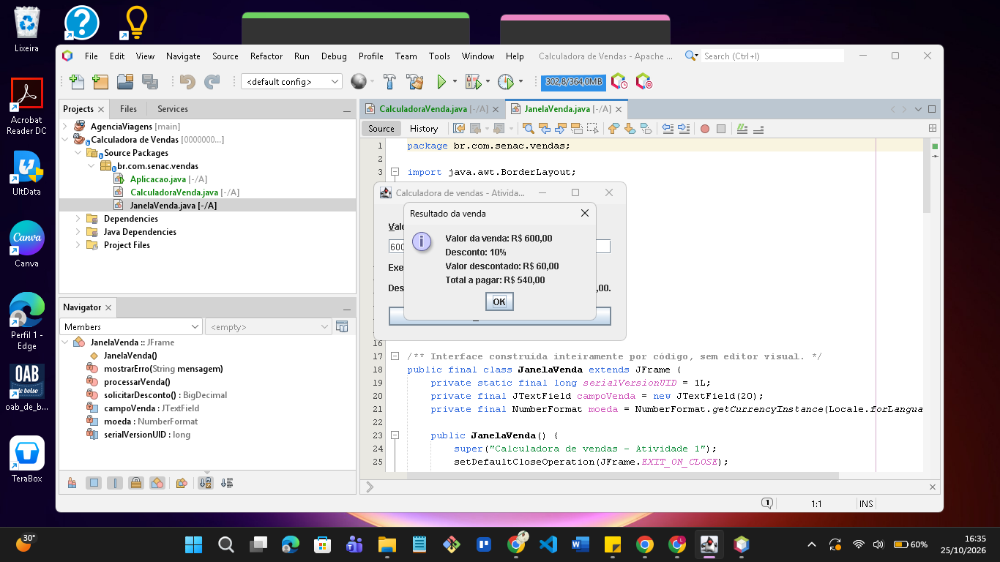
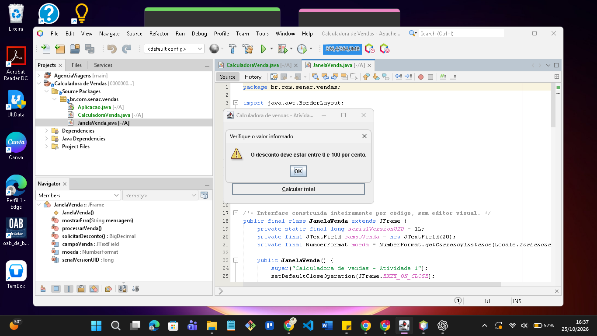

# Calculadora de vendas em Java Swing

Aplicação desktop para calcular o total de uma venda, com solicitação de desconto para valores acima de R$ 500,00. Projeto acadêmico da UC09 — Desenvolver e organizar interface gráfica para aplicações desktop, do curso Técnico em Desenvolvimento de Sistemas do SENAC.

A interface foi construída inteiramente por código Java, sem o editor visual de formulários do NetBeans. A aplicação usa somente bibliotecas do Java SE.

## Funcionalidades

- Janela com campo de valor da venda e botão para calcular.
- Diálogo para informar desconto somente quando a venda é maior que R$ 500,00.
- Resultado com valor original, percentual, valor descontado e total a pagar.
- Validação de campos vazios, formato numérico, venda positiva e desconto entre 0 e 100%.
- Cancelamento do desconto sem concluir a operação.
- Rótulo associado ao campo, descrição acessível, dica de preenchimento e atalhos de teclado.

Exemplos de funcionamento:

| Venda | Desconto | Total |
| --- | --- | --- |
| R$ 400,00 | Sem solicitação | R$ 400,00 |
| R$ 500,00 | Sem solicitação | R$ 500,00 |
| R$ 600,00 | 10% | R$ 540,00 |

## Requisitos

- JDK 17 ou superior.
- Apache NetBeans com suporte a projetos Maven, ou Maven pela linha de comando.
- Ambiente gráfico para executar a interface e os testes Swing.
- Internet na primeira resolução dos plugins Maven.

## Executar no NetBeans

1. Clone ou baixe este repositório.
2. Escolha **File > Open Project** e selecione a pasta que contém `pom.xml`.
3. Configure JDK 17 ou superior para o projeto.
4. Execute **Clean and Build**.
5. Selecione este projeto e execute **Run**. Se a IDE solicitar a classe principal, escolha `br.com.senac.vendas.Aplicacao`.

O projeto foi aberto e os fontes foram conferidos no NetBeans 25. A compilação Maven e a execução do JAR foram verificadas; a execução pelo menu Run da IDE não foi verificada.

## Compilar e executar pelo terminal

Na raiz do repositório:

```sh
mvn package
java -jar target/calculadora-vendas-1.0.jar
```

O JAR é gerado localmente. Os arquivos compilados não são versionados.

## Utilização

Informe um valor positivo como `600`, `600,00` ou `600.00`. Não use `R$` nem separador de milhar. São aceitas até duas casas decimais.

Clique em **Calcular total** ou pressione Enter. Para valores superiores a R$ 500,00, informe um percentual entre 0 e 100, como `10` ou `10,50`. Cancelar ou fechar esse diálogo interrompe o cálculo e preserva o campo da venda.

**Alt+V** seleciona o campo de venda, **Alt+C** aciona o cálculo e **Tab** permite navegar pelos controles. Não foi realizado teste com leitor de tela.

## Organização

```text
src/main/java/br/com/senac/vendas/
  Aplicacao.java          Inicialização na thread de eventos Swing
  JanelaVenda.java        Componentes, eventos e diálogos
  CalculadoraVenda.java   Validação e cálculo com BigDecimal
testes/
  VerificarAplicacao.java Verificador sem bibliotecas externas
evidencias/
  prints_usuario/        Sete capturas da execução manual
  testes-executados.txt   Registro da execução automatizada
```

O cálculo usa `BigDecimal` para representar valores monetários e arredonda o total para duas casas com `HALF_UP`. A regra de desconto usa comparação estritamente maior que 500. As exceções de validação são tratadas com mensagens na interface.

## Testes e evidências

Em 25/10/2026, o verificador concluiu **26 verificações aprovadas** no Windows com OpenJDK 17.0.19. Foram verificados os limites de desconto, o cálculo e arredondamento, formatos inválidos, os diálogos reais e o cancelamento após desconto inválido.

Para repetir no PowerShell com o JDK disponível no PATH:

```powershell
.\testar.ps1
```

O script abre e manipula os componentes reais da aplicação automaticamente. Execute em uma sessão com ambiente gráfico e aguarde o término. Ele atualiza o log e gera imagens dos componentes Swing diretamente em `evidencias`. As capturas manuais da subpasta `prints_usuario` são preservadas.

**`mvn package` não executa esse verificador.** O teste deve ser iniciado pelo script acima.

Veja o [registro dos testes](evidencias/testes-executados.txt) e o [índice das capturas manuais](evidencias/prints_usuario/INDICE.md).

### Resultado com desconto



### Validação do percentual



## Contexto acadêmico

Os materiais da UC orientaram o uso de Swing, componentes, eventos, diálogos, tratamento de exceções, validação, usabilidade e acessibilidade. O enunciado exige interface escrita por código; por isso não há arquivos `.form` nem uso do GUI Builder.

O escopo é um protótipo de cálculo de venda. Não inclui banco de dados, cadastro de produtos ou persistência. Os materiais didáticos e o enunciado do SENAC não estão incluídos neste repositório.

Para a avaliação acadêmica, deve-se enviar o projeto compactado na plataforma do SENAC conforme o enunciado. O repositório é um complemento para organização e portfólio.
